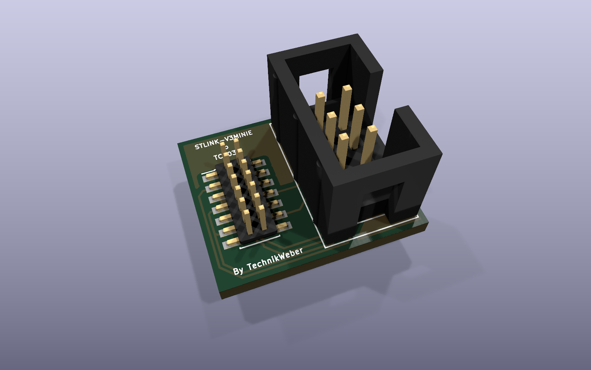

# STDC14 to TC2030-IDC adapter

  
  
  

A tiny adapter PCB from the 14-pin **STDC14** debug connector (1.27 mm, used by the
STLINK-V3MINIE and other STLINK-V3 probes) to a 2×3 2.54 mm IDC header for a
**Tag-Connect TC2030-IDC** (or TC2030-SKEDD) cable — so you can program and debug STM32
boards over SWD with a Tag-Connect footprint instead of a connector.

## Files

- `STDC14_Adapter_to_JTAG_TC2030_SKEDD.kicad_sch` / `.kicad_pcb` — schematic and PCB (KiCad)
- [`production/`](production) — Gerber/drill zip, BOM, positions and netlist, ready to order
  (made with the KiCad Fabrication Toolkit)

 

## License

[MIT](LICENSE).
